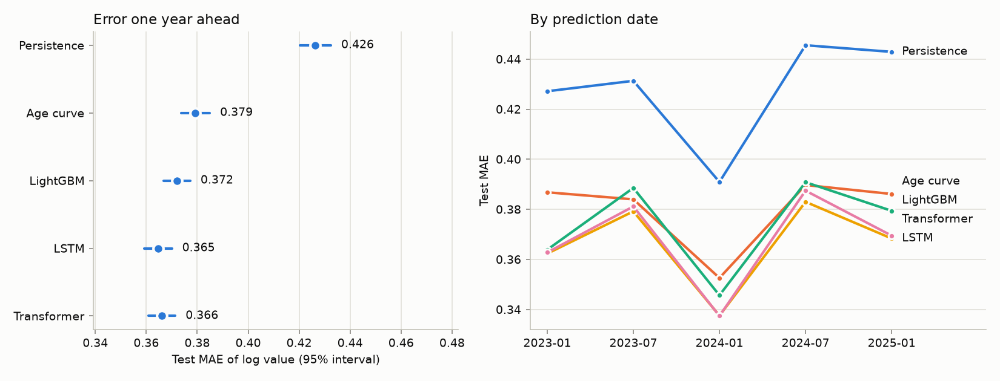

# Market value one year ahead: GBM vs. LSTM vs. Transformer

Pre-registered study: [`docs/preregistration/2026-10-27-market-value.md`](../../docs/preregistration/2026-10-27-market-value.md). One run, 101.0 minutes, seeds [0, 1, 2, 3, 4], device `cpu`.

## Primary outcome

Transformer − LightGBM test MAE: **-0.0060 [-0.0076, -0.0044]** (95% interval from 2,000 resamples of players).

Success criterion (upper end below 0): **met**. The Transformer reading the raw monthly history beats gradient boosting on hand-made summaries.

## Secondary outcomes (not used to decide)

- LSTM − LightGBM: -0.0074 [-0.0092, -0.0056]
- Transformer − LSTM: +0.0014 [+0.0005, +0.0023]
- Age curve − persistence: -0.0470 [-0.0498, -0.0441]
- LightGBM − persistence: -0.0542 [-0.0577, -0.0506]
- LSTM − persistence: -0.0615 [-0.0648, -0.0583]
- Transformer − persistence: -0.0601 [-0.0634, -0.0568]

## Test anchors (31,220 samples)

MAE is on the log scale: 0.30 means the predicted value is typically about 35% off (exp(0.30) − 1). Median absolute % error and the share within ±20% read the same predictions as euros.

| model | MAE | RMSE | median abs. % error | within ±20% | bias |
| --- | --- | --- | --- | --- | --- |
| Persistence | 0.426 | 0.610 | 33.3% | 31.7% | +0.031 |
| Age curve | 0.379 | 0.546 | 26.6% | 38.0% | -0.030 |
| LightGBM | 0.372 | 0.522 | 27.4% | 38.9% | +0.038 |
| LSTM | 0.365 | 0.527 | 25.4% | 41.0% | -0.047 |
| Transformer | 0.366 | 0.524 | 25.8% | 40.6% | -0.033 |

## By prediction date

| anchor | n | Persistence | Age curve | LightGBM | LSTM | Transformer |
| --- | --- | --- | --- | --- | --- | --- |
| 2023-01-01 | 7,246 | 0.427 | 0.387 | 0.364 | 0.362 | 0.363 |
| 2023-07-01 | 5,907 | 0.431 | 0.384 | 0.389 | 0.379 | 0.381 |
| 2024-01-01 | 6,756 | 0.391 | 0.353 | 0.346 | 0.338 | 0.337 |
| 2024-07-01 | 5,065 | 0.446 | 0.390 | 0.391 | 0.383 | 0.387 |
| 2025-01-01 | 6,246 | 0.443 | 0.386 | 0.379 | 0.368 | 0.370 |

## By group (test MAE)

| group | level | n | Persistence | Age curve | LightGBM | LSTM | Transformer |
| --- | --- | --- | --- | --- | --- | --- | --- |
| value at t | < €1m | 12,594 | 0.431 | 0.391 | 0.391 | 0.381 | 0.384 |
| value at t | €1–5m | 10,249 | 0.449 | 0.393 | 0.379 | 0.377 | 0.376 |
| value at t | €5–20m | 5,865 | 0.428 | 0.377 | 0.364 | 0.354 | 0.356 |
| value at t | ≥ €20m | 2,512 | 0.305 | 0.273 | 0.272 | 0.256 | 0.257 |
| age at t | ≤ 21 | 5,743 | 0.608 | 0.579 | 0.559 | 0.557 | 0.556 |
| age at t | 22–25 | 10,020 | 0.391 | 0.391 | 0.388 | 0.378 | 0.379 |
| age at t | 26–29 | 8,682 | 0.343 | 0.317 | 0.312 | 0.299 | 0.301 |
| age at t | ≥ 30 | 6,775 | 0.433 | 0.274 | 0.268 | 0.266 | 0.271 |
| position | Attack | 8,897 | 0.445 | 0.403 | 0.397 | 0.385 | 0.387 |
| position | Defender | 10,643 | 0.410 | 0.362 | 0.351 | 0.346 | 0.347 |
| position | Goalkeeper | 2,434 | 0.416 | 0.367 | 0.371 | 0.366 | 0.372 |
| position | Midfield | 9,246 | 0.430 | 0.380 | 0.372 | 0.367 | 0.367 |
| league | BE1 | 2,165 | 0.472 | 0.439 | 0.430 | 0.423 | 0.422 |
| league | DK1 | 1,488 | 0.453 | 0.401 | 0.379 | 0.391 | 0.388 |
| league | ES1 | 2,657 | 0.486 | 0.416 | 0.402 | 0.401 | 0.398 |
| league | FR1 | 2,454 | 0.472 | 0.425 | 0.411 | 0.403 | 0.401 |
| league | GB1 | 2,644 | 0.382 | 0.330 | 0.312 | 0.308 | 0.309 |
| league | GR1 | 1,877 | 0.320 | 0.256 | 0.247 | 0.245 | 0.247 |
| league | IT1 | 2,685 | 0.428 | 0.377 | 0.373 | 0.359 | 0.360 |
| league | L1 | 2,346 | 0.448 | 0.404 | 0.396 | 0.387 | 0.390 |
| league | NL1 | 2,319 | 0.442 | 0.417 | 0.409 | 0.406 | 0.409 |
| league | PO1 | 2,415 | 0.426 | 0.410 | 0.393 | 0.382 | 0.384 |
| league | RU1 | 2,104 | 0.360 | 0.319 | 0.332 | 0.321 | 0.321 |
| league | SC1 | 1,493 | 0.366 | 0.315 | 0.339 | 0.334 | 0.337 |
| league | TR1 | 2,608 | 0.466 | 0.386 | 0.377 | 0.359 | 0.367 |
| league | UKR1 | 1,965 | 0.396 | 0.369 | 0.375 | 0.365 | 0.370 |
| value changed | changed | 26,697 | 0.498 | 0.420 | 0.402 | 0.398 | 0.398 |
| value changed | unchanged | 4,523 | 0.000 | 0.140 | 0.196 | 0.167 | 0.177 |

## Validation anchors

| model | MAE | RMSE | median abs. % error | within ±20% | bias |
| --- | --- | --- | --- | --- | --- |
| Persistence | 0.418 | 0.580 | 33.3% | 32.0% | +0.098 |
| Age curve | 0.380 | 0.524 | 28.6% | 36.6% | +0.026 |
| LightGBM | 0.355 | 0.486 | 26.3% | 39.6% | +0.021 |
| LSTM | 0.349 | 0.485 | 25.5% | 40.9% | -0.012 |
| Transformer | 0.348 | 0.483 | 25.2% | 41.2% | -0.016 |

## Training details

- LightGBM best rounds: [230, 254, 290, 376, 416].
- LSTM: seed 0 epoch 10 (val MAE 0.3504, 200s), seed 1 epoch 10 (val MAE 0.3511, 202s), seed 2 epoch 11 (val MAE 0.3517, 206s), seed 3 epoch 9 (val MAE 0.3516, 184s), seed 4 epoch 8 (val MAE 0.3512, 176s)
- Transformer: seed 0 epoch 15 (val MAE 0.3503, 1187s), seed 1 epoch 10 (val MAE 0.3493, 961s), seed 2 epoch 8 (val MAE 0.3505, 892s), seed 3 epoch 10 (val MAE 0.3512, 965s), seed 4 epoch 11 (val MAE 0.3505, 1014s)
- LightGBM feature importance (share of gain, top 12): age 22.1%, log_value 12.4%, league_min90_6m 8.0%, league 6.8%, momentum 6.1%, below_peak_36m 3.3%, months_since_revaluation 3.2%, value_change_6m 3.0%, last_transfer_fee_log 2.8%, goals_6m 2.1%, sub_position 2.0%, league_strength_12m 1.9%.
