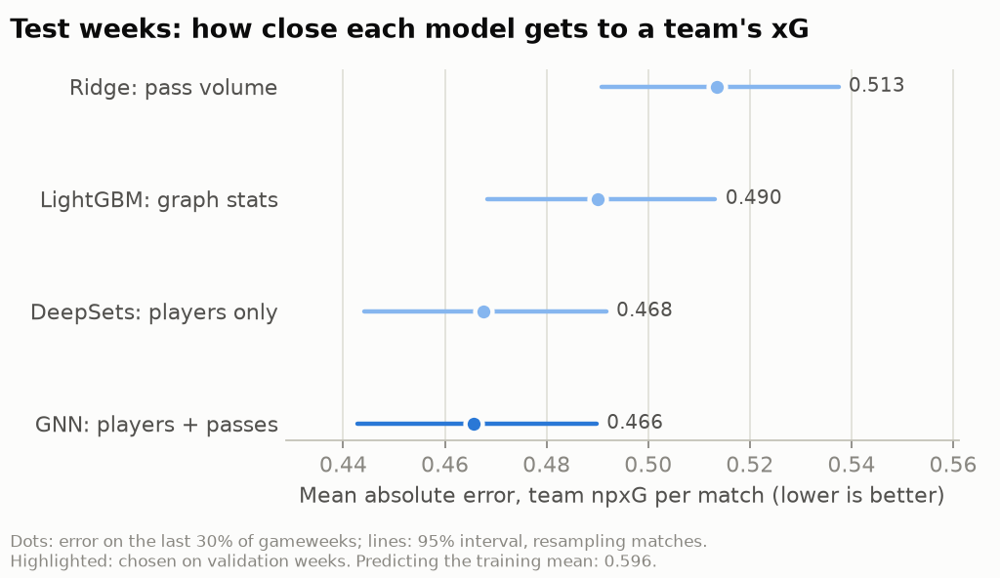

# Passing networks → team xG

Can a team's passing network in a match tell us how many chances it created? Each team in each match is a graph: players are nodes, completed passes between them are directed, weighted edges. The target is the team's **non-penalty xG** in that match, from the project's xG model (`lgbm@2026-10-26T13:08:31+00:00`). Shots never enter the features.

## Data and split

3,882 team-match graphs. The split is by time and fixed in advance: in each league the first 70% of gameweeks are for fitting (the last 5 of those for early stopping) and the last 30% for testing; World Cup 2018 and Euro 2016 are a separate test set the models never train on.

| split | graphs |
| --- | --- |
| train | 2,102 |
| val | 490 |
| test | 1,060 |
| test_intl | 230 |

## Models

Five models of increasing structure, all fitted on the same training weeks. DeepSets and the GNN see the same player features; only the GNN also sees who passes to whom. If the GNN beats DeepSets, the network structure carries information beyond each player's own numbers.

Neural models: 5 seeds each, hidden size 64, 3 GINE layers (GNN), Adam lr 0.001, weight decay 0.0001, early stopping on validation MSE (patience 30). Their rows below are the average of the seeds' predictions.

The model carried into Phase 2 is chosen on the **validation weeks** (lowest MAE): **gnn**.

## Results: league test weeks

| model | description | MAE | RMSE | R² | Spearman |
| --- | --- | --- | --- | --- | --- |
| mean | Training mean | 0.596 | 0.763 | -0.001 | – |
| volume | Ridge on pass volume | 0.513 | 0.651 | 0.272 | 0.526 |
| lgbm_stats | LightGBM on 19 graph statistics | 0.490 | 0.630 | 0.318 | 0.551 |
| deepsets | DeepSets: players, no passes between them | 0.468 | 0.608 | 0.365 | 0.582 |
| **gnn** | GNN: players + who passes to whom | 0.466 | 0.609 | 0.363 | 0.583 |

## Results: World Cup + Euro (never trained on)

| model | description | MAE | RMSE | R² | Spearman |
| --- | --- | --- | --- | --- | --- |
| mean | Training mean | 0.559 | 0.697 | -0.038 | – |
| volume | Ridge on pass volume | 0.458 | 0.586 | 0.265 | 0.587 |
| lgbm_stats | LightGBM on 19 graph statistics | 0.445 | 0.580 | 0.281 | 0.613 |
| deepsets | DeepSets: players, no passes between them | 0.411 | 0.542 | 0.371 | 0.685 |
| **gnn** | GNN: players + who passes to whom | 0.418 | 0.552 | 0.348 | 0.671 |

## Is the difference real?

Paired difference in absolute error on the league test weeks (negative = first model better), 95% interval from 2,000 bootstrap resamples of matches:

- gnn - deepsets: -0.0018 [-0.0081, +0.0046]
- gnn - lgbm_stats: -0.0244 [-0.0373, -0.0115]
- deepsets - lgbm_stats: -0.0226 [-0.0351, -0.0108]

Seed-to-seed spread on the test weeks (single models, not the ensemble):

| model | MAE mean ± sd | R² mean ± sd | mean best epoch |
| --- | --- | --- | --- |
| deepsets | 0.469 ± 0.002 | 0.359 ± 0.005 | 47 |
| gnn | 0.471 ± 0.008 | 0.346 ± 0.016 | 66 |

## Limitations

- A match's xG is noisy: much of it depends on a few chances, so even a perfect model of the passing network explains only part of it.
- The receiver of a pass is inferred from the next event (found for 99% of accurate passes).
- One season per league; the xG model used for the target was fitted on all shots of that season.
- The graph describes the same match whose xG it predicts; it explains a performance, it does not forecast the next one. Phase 2 uses it for counterfactual player swaps.
