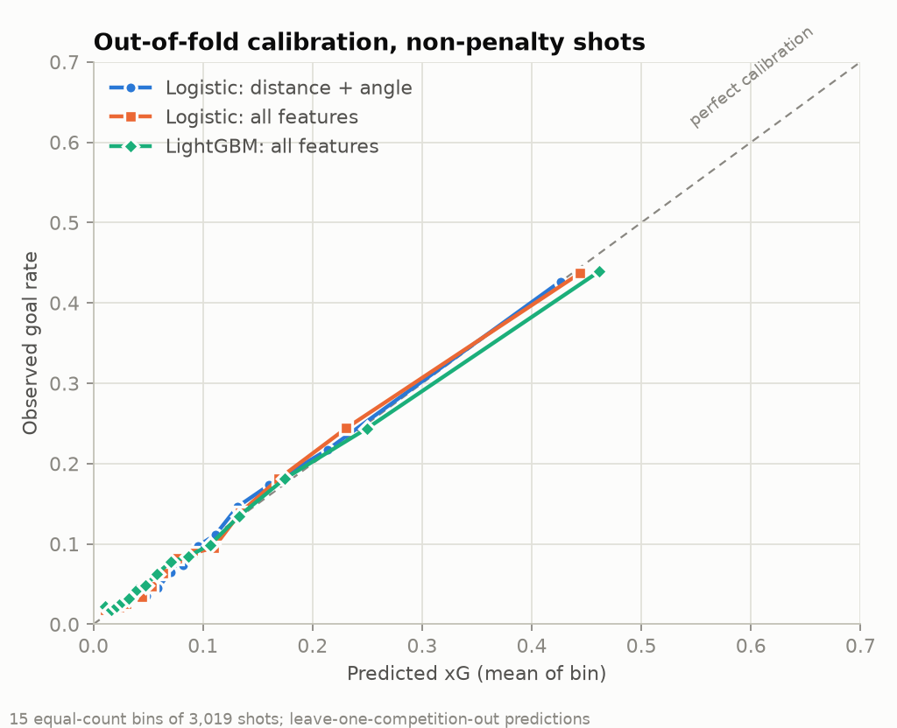
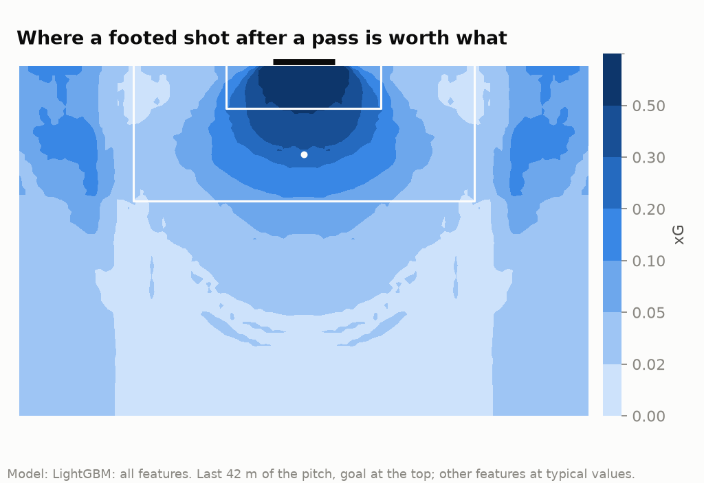
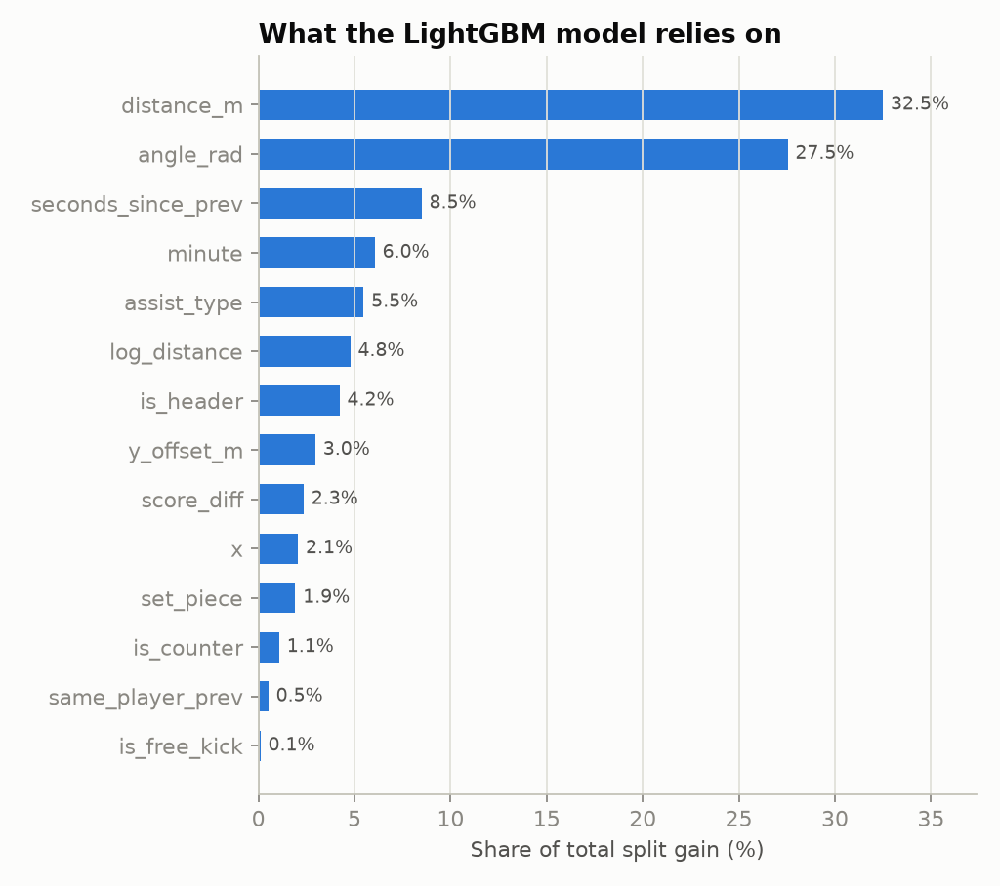

# Expected goals (xG) — evaluation

Model in use: **LightGBM: all features** (`lgbm`), trained 2026-10-26T13:08:31+00:00 on 45,869 shots. Penalties get a fixed xG of 0.727, the conversion rate of the training penalties.

## Data

Wyscout public dataset, 2017/18: five leagues, World Cup 2018, Euro 2016. 45,869 shots, 5,052 goals. 25 shots recorded on the wrong half were mirrored back (see `features/xg/shots.py`).

| shot_type | shots | goals | goal_rate |
| --- | --- | --- | --- |
| free_kick | 2209 | 137 | 0.062 |
| open_play | 43078 | 4492 | 0.104 |
| penalty | 582 | 423 | 0.727 |

Features use only what is known before the strike: shot location (distance, angle, lateral offset), header or foot, how the chance was created (pass, cross, through ball, dribble, rebound, loose ball, aerial duel), set-piece origin, counter-attack, time since the team's previous action, minute and score difference. Wyscout tags that describe the outcome are excluded: `opportunity` (201) sits on 99% of goals, plus accuracy (1801/1802), goal-mouth position (1201–1223) and `blocked` (2101).

## Validation

Leave one competition out: each of the seven competitions is predicted by models trained on the other six. The model is chosen by a rule fixed in advance: lowest pooled out-of-fold log loss. Metrics below cover non-penalty shots.

| model | description | log_loss | brier | roc_auc | ece | xg_over_goals |
| --- | --- | --- | --- | --- | --- | --- |
| baseline | Constant rate | 0.3300 | 0.0918 | – | 0.0063 | 0.998 |
| lr_geometry | Logistic: distance + angle | 0.2805 | 0.0798 | 0.772 | 0.0057 | 1.000 |
| lr_full | Logistic: all features | 0.2753 | 0.0786 | 0.785 | 0.0053 | 1.001 |
| lgbm | LightGBM: all features | 0.2750 | 0.0785 | 0.785 | 0.0039 | 1.000 |

- `log_loss`, `brier`: lower is better. `roc_auc`: ranking quality. `ece`: mean gap between predicted and observed rates over 10 equal-count bins. `xg_over_goals`: total xG / total goals (1.0 = unbiased).
- The constant model is the floor: any useful model must beat its log loss.

Paired difference in per-shot log loss, 95% interval from 2,000 bootstrap resamples of matches:

- lgbm - lr_full: -0.00031 [-0.00133, +0.00068]
- lgbm - lr_geometry: -0.00549 [-0.00691, -0.00415]

### By held-out competition (log loss; goals vs xG for the model in use)

| competition | baseline | lr_geometry | lr_full | lgbm | n | goals | xg_over_goals |
| --- | --- | --- | --- | --- | --- | --- | --- |
| English first division | 0.3380 | 0.2880 | 0.2815 | 0.2807 | 8801 | 932 | 1.016 |
| European Championship | 0.2723 | 0.2364 | 0.2329 | 0.2360 | 1283 | 97 | 1.141 |
| French first division | 0.3286 | 0.2823 | 0.2777 | 0.2786 | 8848 | 899 | 0.976 |
| German first division | 0.3388 | 0.2874 | 0.2835 | 0.2826 | 7197 | 765 | 0.983 |
| Italian first division | 0.3174 | 0.2680 | 0.2623 | 0.2613 | 9221 | 889 | 1.040 |
| Spanish first division | 0.3429 | 0.2895 | 0.2850 | 0.2845 | 8432 | 912 | 0.967 |
| World Cup | 0.3028 | 0.2573 | 0.2477 | 0.2481 | 1505 | 135 | 1.012 |

## Figures

## Limitations

- Event data has no defender or goalkeeper positions, so a shot under pressure and an open shot from the same spot get the same xG. Freeze-frame data (e.g. StatsBomb) would address this.
- One season per competition. Leave-one-competition-out tests transfer across leagues, not across time.
- Own goals carry no xG: team xG will sit slightly below goals by construction.
